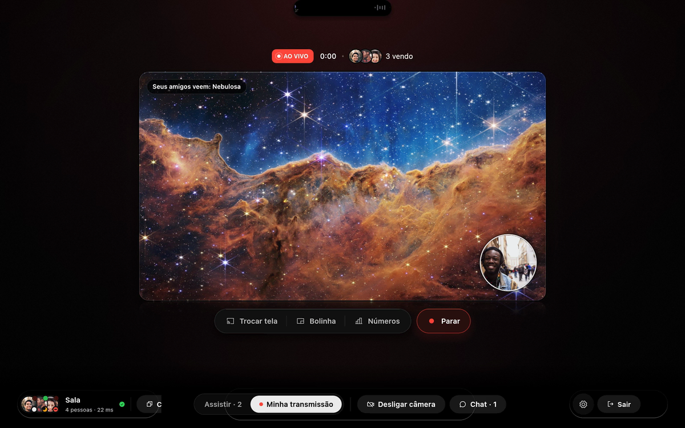
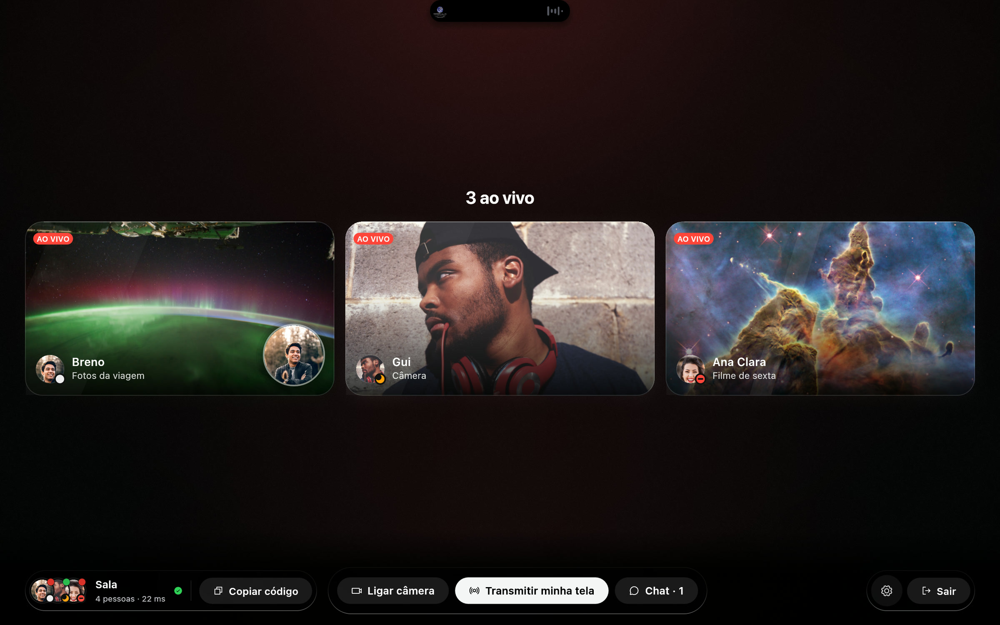
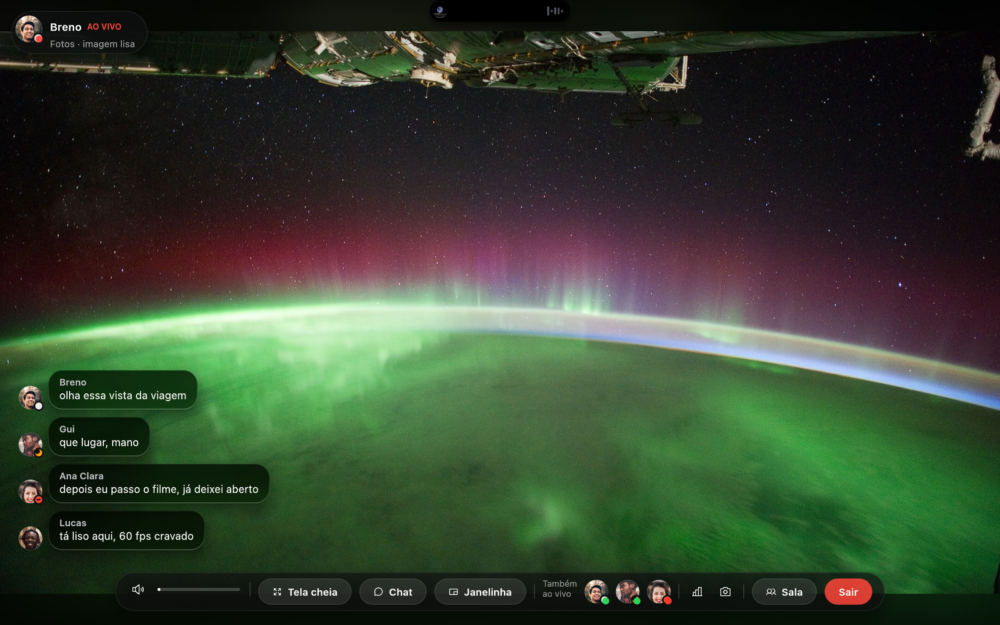
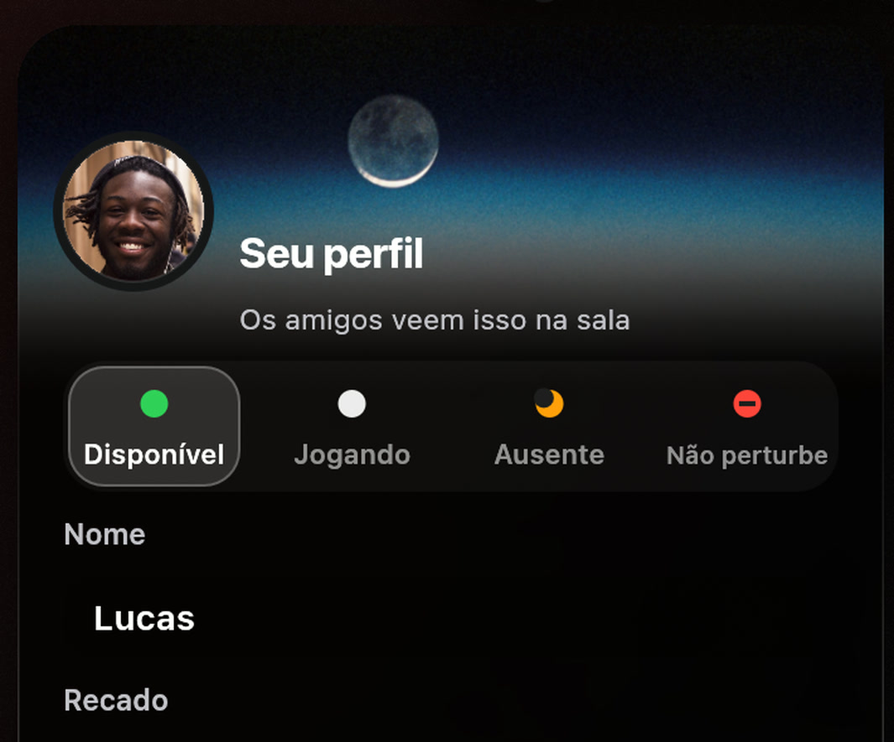
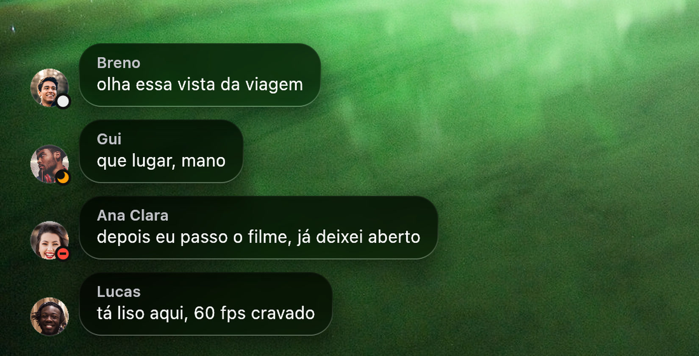
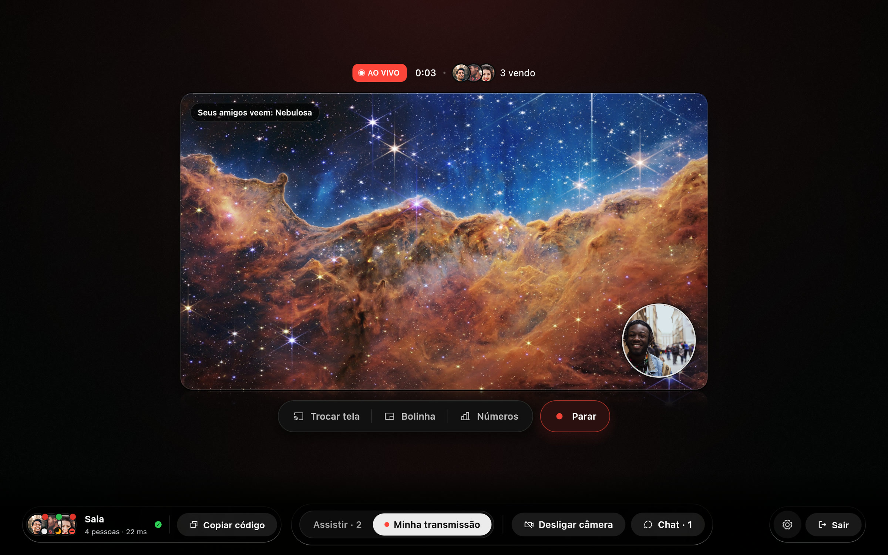
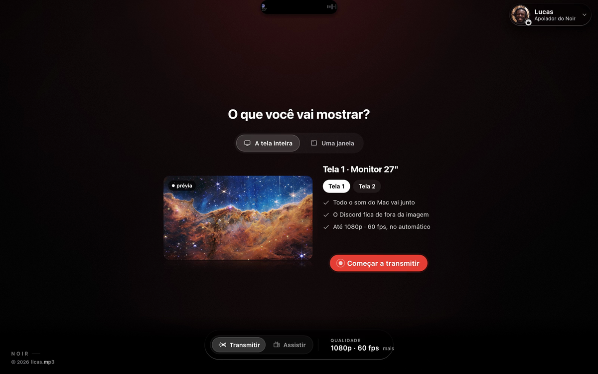

  

 

  <a href="https://github.com/licasmp4/Noir-downloads/releases/download/mac/Noir.dmg"><picture><source media="(prefers-color-scheme: dark)" srcset="docs/baixar-mac-escuro.svg"></picture></a>
  &nbsp;&nbsp;
  <a href="https://github.com/licasmp4/Noir-downloads/releases/download/windows/Noir-Setup.exe"><picture><source media="(prefers-color-scheme: dark)" srcset="docs/baixar-windows-escuro.svg"></picture></a>

De graça, sem conta e sem cartão. &nbsp;·&nbsp; <a href="https://noir-signal.lucasgluiz-9.workers.dev">Site do Noir</a>

 

  

Sua tela, sua câmera e os amigos vendo ao vivo. A câmera muda de jeito sem parar a transmissão.

 

<h2 align="center">Três passos e pronto.</h2>

 

  <picture><source media="(prefers-color-scheme: dark)" srcset="docs/passos-escuro.svg"></picture>

  

 

<h2 align="center">A tela inteira ou só o jogo.</h2>

A tela inteira ou uma janela. As janelas abertas aparecem numa fileira com o ícone de cada app: arraste pro lado e clique na sua. Escolheu o jogo? Só ele vai pros amigos, e o Discord fica de fora.

  

 

<h2 align="center">A sala dos amigos.</h2>

  

A tela e a câmera de cada um, e janelinhas que flutuam por cima do jogo. A sala pode ser privada: quem chega bate na porta.

 

  

Assistindo um amigo: as mensagens chegam em vidro, com a foto de quem mandou. Enter responde sem sair da tela.

 

<table>
<tr>
<td width="50%"></td>
<td width="50%"></td>
</tr>
<tr>
<td align="center"><b>Status com um clique.</b> Disponível, Jogando, Ausente ou Não perturbe. Os amigos veem a bolinha na sua foto na hora.</td>
<td align="center"><b>Chat com as fotos.</b> Mensagens da mesma pessoa se juntam e somem sozinhas.</td>
</tr>
</table>

 

  

Sua transmissão: há quanto tempo está ao vivo, quem está vendo e o que chega pros amigos. Cinco jeitos de juntar tela e câmera, num menu de vidro.

 

  

A ilha mostra a música e os avisos da sala com a foto do amigo, e o botão do fone troca a saída de som. Transmitindo, ela fica por cima do jogo, troca de mesa com você e aparece pros amigos junto com a tela. Se você quiser, quem te assiste vê o que você está ouvindo.

 

  <picture><source media="(prefers-color-scheme: dark)" srcset="docs/recursos-escuro.svg"></picture>

 

<h2 align="center">O que mudou</h2>

<b>14 de novembro de 2026</b>

| | |
|:---|:---|
| **Placa sem bagunça** | No Jogar aqui, resolução e quadros num menu só; Menor atraso num interruptor. |
| **Ilha mais leve** | Aberta, roda lisa mesmo com coisa mexendo atrás do vidro. |
| **Amigos veem a ilha** | Ela aparece na transmissão, nos prints e nas gravações. |
| **Voo com a música** | Começou a transmitir com música, a ilha sobe com a capa e a onda numa mola só. |
| **Botões que respondem** | Com o mouse em cima, os botões acendem de verdade. |
| **Status com um clique** | Disponível, Jogando, Ausente ou Não perturbe. Os amigos veem na hora, e no Não perturbe a ilha fica quieta. |
| **Chat com as fotos** | Assistindo um amigo, as mensagens aparecem em vidro com a foto de quem mandou. |
| **Avisos com foto** | Quem entrou, saiu ou começou a transmitir chega na ilha com a foto do amigo. |
| **Layouts em vidro** | O menu dos cinco layouts da câmera virou vidro. |
| **Uma janela** | A fileira de janelas anda arrastando, e os ícones dos apps aparecem na hora. |
| **A ilha vai junto** | Trocou de área de trabalho, a ilha vai com você, no Mac e no Windows. |
| **Botão do fone** | Abre as saídas de som dentro da ilha, por cima do jogo. |

<b>12 de novembro de 2026</b>

| | |
|:---|:---|
| **Sala privada** | Quem chega bate na porta, e você deixa entrar ou recusa. |
| **Código fixo** | Sua sala volta sempre com o mesmo código. |
| **Sua música pra quem assiste** | Opcional, em Ajustes › Ilha: quem te assiste vê o que você ouve, com a sua foto no canto da capa, e abre no Spotify. |
| **Telas mais calmas** | Transmitir, Assistir, a sala, sua transmissão e os Ajustes com menos botões à vista. |
| **Início contido** | Duas portas, o código numa linha e os amigos em lista. |
| **Chat na ilha** | As mensagens aparecem na ilha do topo; o painel do chat começa fechado. |
| **Fumaça de verdade** | O mascote sobe do café e se desfaz pelas bordas. |

 

<h2 align="center">Instalar</h2>

<table>
  <tr>
    <td width="50%" valign="top">
      <h3>Mac</h3>
      Abra o <code>Noir.dmg</code> e arraste o Noir para <b>Aplicativos</b>.  
      Na primeira vez, o macOS bloqueia o app porque ele ainda não é assinado pela Apple. Tente abrir, depois vá em <b>Ajustes do Sistema › Privacidade e Segurança</b> e clique em <b>Abrir Mesmo Assim</b>. Depois, permita <b>Gravação de Tela e Áudio do Sistema</b>.  
      macOS 26 ou mais novo, em Mac com chip Apple.
    </td>
    <td width="50%" valign="top">
      <h3>Windows</h3>
      Abra o <code>Noir-Setup.exe</code>. Não pede senha de administrador, e dá pra desinstalar em <b>Configurações › Aplicativos</b>.  
      Se o Windows avisar que o app é desconhecido, clique em <b>Mais informações › Executar assim mesmo</b>.  
      Windows 10 ou 11, 64 bits.
    </td>
  </tr>
</table>

**Atualizar:** não precisa baixar de novo. No app, **Ajustes › Geral › Procurar atualização** baixa e instala a versão nova.

 

Criado por <a href="https://github.com/licasmp4"><b>licas.mp3</b></a>

Este repositório guarda só os instaladores. Imagens nas telas dos prints: NASA, ESA, CSA e STScI (James Webb, Hubble e Estação Espacial), em domínio público. Pessoas: fotos em domínio público (CC0) do Wikimedia Commons. Apple, macOS e Windows são marcas de seus donos; o Noir não tem ligação com eles.

