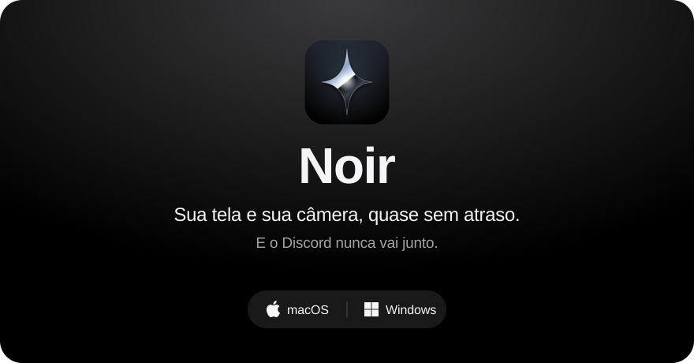
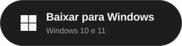
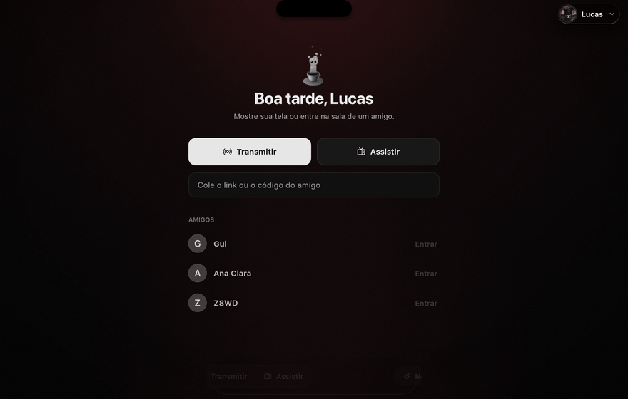
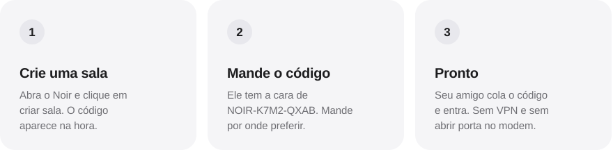
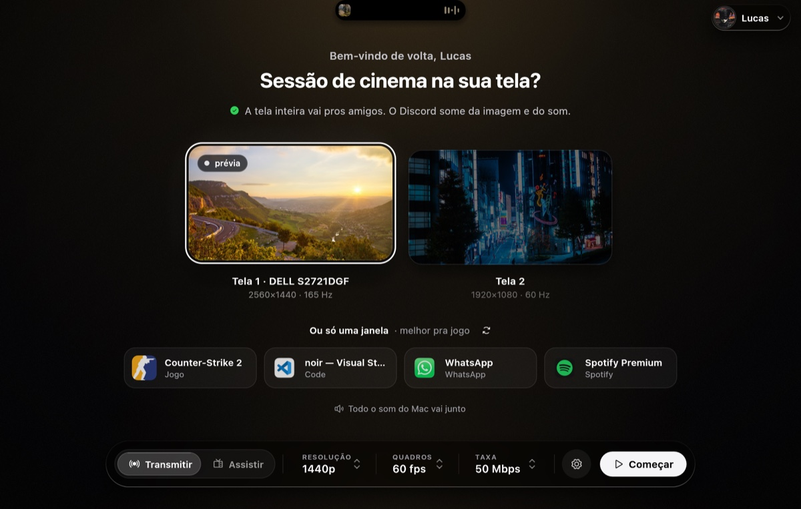
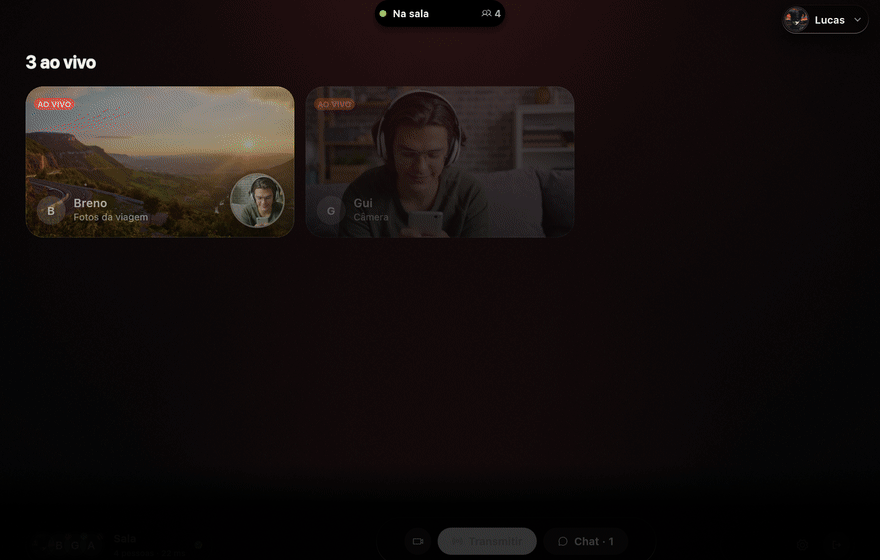
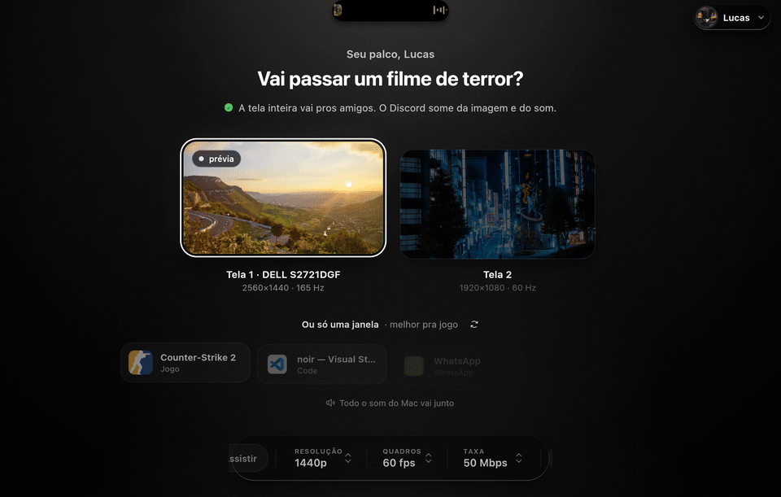
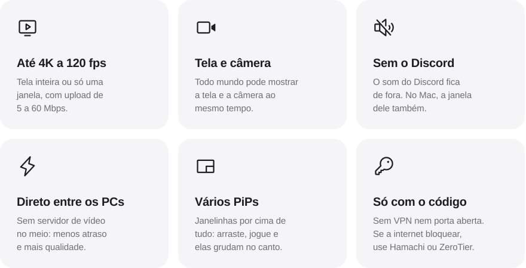

  

 

  <a href="https://github.com/licasmp4/Noir-downloads/releases/download/mac/Noir.dmg"><picture><source media="(prefers-color-scheme: dark)" srcset="docs/baixar-mac-escuro.svg"></picture></a>
  &nbsp;&nbsp;
  <a href="https://github.com/licasmp4/Noir-downloads/releases/download/windows/Noir-Setup.exe"><picture><source media="(prefers-color-scheme: dark)" srcset="docs/baixar-windows-escuro.svg"></picture></a>

De graça, sem conta e sem cartão. &nbsp;·&nbsp; <a href="https://noir-signal.lucasgluiz-9.workers.dev">Site do Noir</a>

 

  

 

<h2 align="center">Três passos e pronto.</h2>

 

  <picture><source media="(prefers-color-scheme: dark)" srcset="docs/passos-escuro.svg"></picture>

 

<h2 align="center">A tela inteira ou só o jogo.</h2>

Cada janela aberta aparece com o ícone de verdade do app. Escolheu o CS2? Só ele vai pros amigos.

  

 

<h2 align="center">A sala dos amigos.</h2>

  

A tela e a câmera de cada um, o chat do lado e janelinhas que flutuam por cima do jogo.

 

  

A ilha do topo mostra a música que está tocando e os avisos da sala.

 

  <picture><source media="(prefers-color-scheme: dark)" srcset="docs/recursos-escuro.svg"></picture>

 

<h2 align="center">O que mudou</h2>

<b>9 de novembro de 2026</b>

| | |
|:---|:---|
| **Mais resistente** | Testado na marra (sala lotada, imagens gigantes, mensagens quebradas) e não caiu. |
| **Ajustes** | Os nomes das abas voltaram a aparecer; ícones só no traço. |
| **Holofote** | Cor do fundo mais leve. |
| **Ícone de verdade** | Cada janela aparece com o ícone do próprio app. |
| **Tela não encontrada** | Acabou o erro em PCs com mais de um monitor. |
| **Pode sair de perto** | Transmitindo, o computador não dorme e a tela não apaga. |
| **Mais fácil de ler** | Textos com mais contraste e nada de "ao vivo" antes da hora. |
| **Sala vazia** | Um botão grande pra copiar o código e chamar os amigos. |
| **Aba Geral** | Idioma Português ou English, perfil abrindo suave. |
| **Animações** | Mais calmas, e a opção Menos movimento. |

 

<h2 align="center">Instalar</h2>

<table>
  <tr>
    <td width="50%" valign="top">
      <h3>Mac</h3>
      Abra o <code>Noir.dmg</code> e arraste o Noir para <b>Aplicativos</b>.  
      Na primeira vez, o macOS bloqueia o app porque ele ainda não é assinado pela Apple. Tente abrir, depois vá em <b>Ajustes do Sistema › Privacidade e Segurança</b> e clique em <b>Abrir Mesmo Assim</b>. Depois, permita <b>Gravação de Tela e Áudio do Sistema</b>.  
      macOS 26 ou mais novo, em Mac com chip Apple.
    </td>
    <td width="50%" valign="top">
      <h3>Windows</h3>
      Abra o <code>Noir-Setup.exe</code>. Não pede senha de administrador, e dá pra desinstalar em <b>Configurações › Aplicativos</b>.  
      Se o Windows avisar que o app é desconhecido, clique em <b>Mais informações › Executar assim mesmo</b>.  
      Windows 10 ou 11, 64 bits.
    </td>
  </tr>
</table>

**Atualizar:** não precisa baixar de novo. No app, **Ajustes › Geral › Procurar atualização** baixa e instala a versão nova.

 

Criado por <a href="https://github.com/licasmp4"><b>licas.mp3</b></a> e <a href="https://github.com/brenoalq"><b>brenoalq</b></a>

Este repositório guarda só os instaladores. Apple, macOS e Windows são marcas de seus donos; o Noir não tem ligação com eles.

